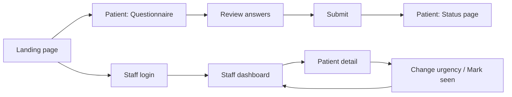

# Hospital Triage App – Design System

**Course:** CST3106 – Internet Architecture and Web Development
**Lab 10:** Hospital Triage Design System
**Author:** Omar Mahamoud (individual submission)
**Repository:** `<link to your GitHub repo>`

---

## 1. Design Overview

The Hospital Triage app has two audiences with very different needs:

| Audience | Context | Design priority |
|---|---|---|
| **Patients (User page)** | Often in pain, anxious, possibly on a phone in a waiting room | Calm, simple, minimal typing, one clear action at a time |
| **Staff (Staff dashboard)** | Busy, high-pressure, scanning many patients quickly | Density, scannability, urgency stands out instantly |

**Guiding principles**

1. **Clarity over decoration.** Every element has one job and is obvious at a glance.
2. **Calm for patients, focused for staff.** The two pages share one identity but use different colour "moods".
3. **Never rely on colour alone.** Urgency is always communicated with colour *and* text/icon.
4. **Mobile-first and accessible.** Targets WCAG 2.1 AA.

---

## 2. Fonts

### 2.1 Font families

| Role | Font | Fallback stack | Used for |
|---|---|---|---|
| **Headings & UI** | **Inter** | `"Segoe UI", Arial, sans-serif` | Titles, buttons, labels, navigation, table headers |
| **Body & data** | **Inter** | `"Segoe UI", Arial, sans-serif` | Paragraphs, form text, table cells |
| **Numbers / IDs** | **Roboto Mono** | `Consolas, monospace` | Patient IDs, wait-time counters, timestamps |

```css
:root {
  --font-sans: "Inter", "Segoe UI", Arial, sans-serif;
  --font-mono: "Roboto Mono", Consolas, monospace;
}
body { font-family: var(--font-sans); font-size: 1rem; line-height: 1.5; }
```

### 2.2 Weights and scale

| Token | Weight | Sample use |
|---|---|---|
| Regular | 400 | Body text, descriptions |
| Medium | 500 | Form labels, table headers |
| Semi-bold | 600 | Buttons, sub-headings |
| Bold | 700 | Page titles, urgent alerts |

| Element | Size | Weight |
|---|---|---|
| Page title (H1) | 2rem (32px) | 700 |
| Section heading (H2) | 1.5rem (24px) | 600 |
| Sub-heading (H3) | 1.25rem (20px) | 600 |
| Body | 1rem (16px) | 400 |
| Helper / caption | 0.875rem (14px) | 400 |
| Button text | 1rem (16px) | 600 |

### 2.3 Why these fonts

- **Inter** was designed for screens: tall x-height and open letterforms keep text readable on small phone displays and at a distance on a staff monitor.
- Characters such as `I`, `l`, and `1` are easy to tell apart, which matters when reading patient IDs and times.
- Using **one family in multiple weights** keeps the interface consistent and fast to load, while weight (not a second typeface) creates hierarchy.
- **Roboto Mono** gives numbers equal width, so wait times and IDs line up in columns on the staff dashboard.
- Minimum body size is **16px** to avoid zoom on mobile and help older or stressed readers.

---

## 3. Colour Palette

### 3.1 Shared neutrals and text

| Swatch | Name | Hex | Use | Contrast |
|---|---|---|---|---|
|  | Ink | `#1B2430` | Primary text | 15.6:1 on white |
|  | Slate Grey | `#6B7785` | Secondary text, borders | 4.6:1 on white |
|  | White | `#FFFFFF` | Cards, inputs | – |

### 3.2 User (Patient) page – "Calm"

| Swatch | Name | Hex | Use | Contrast |
|---|---|---|---|---|
|  | Care Blue | `#1F5FA8` | Primary buttons, headings, links | 6.4:1 with white text |
|  | Soft Blue | `#E8F0FA` | Highlight panels, selected options | 13.6:1 with Ink |
|  | Mist Grey | `#F4F6F8` | Page background | 14.5:1 with Ink |
|  | Confirm Green | `#2E7D32` | Success / "submitted" messages | 5.1:1 with white text |
|  | Error Red | `#B3261E` | Form errors | 6.5:1 with white text |

**Reasoning:** Blue is widely associated with trust, calm, and healthcare, which helps reduce patient anxiety. A light grey background reduces glare and eye strain in bright or dim waiting rooms. Red is reserved *only* for errors so it never causes unnecessary alarm.

### 3.3 Staff page – "Focus"

| Swatch | Name | Hex | Use | Contrast |
|---|---|---|---|---|
|  | Charcoal | `#263238` | Header, sidebar, table header | 13.2:1 with white text |
|  | Cool Grey | `#ECEFF1` | Dashboard background | 13.6:1 with Ink |
|  | Action Blue | `#1565C0` | Primary staff actions | 5.8:1 with white text |
|  | Alert Red | `#C62828` | Critical alerts, destructive actions | 5.6:1 with white text |

**Reasoning:** A darker, more neutral frame signals a professional tool and lets coloured urgency badges stand out. Red appears only for alerts and urgent actions, so staff learn that "red = look now".

### 3.4 Urgency (triage level) colours

Used on the staff dashboard and on the patient's status screen. Each level has a **label and number**, so colour is never the only cue.

| Level | Label | Colour | Hex | Text colour |
|---|---|---|---|---|
| 1 | Critical |  Red | `#C62828` | White |
| 2 | Emergent |  Burnt Orange | `#B45309` | White |
| 3 | Urgent |  Amber | `#F9C74F` | Ink |
| 4 | Less Urgent |  Green | `#2E7D32` | White |
| 5 | Non-urgent |  Blue | `#1F5FA8` | White |

*(All combinations above meet at least 4.5:1 contrast.)*

### 3.5 CSS variables

```css
:root {
  /* Neutrals */
  --ink: #1B2430;
  --slate: #6B7785;
  --white: #FFFFFF;

  /* User page */
  --user-primary: #1F5FA8;
  --user-soft: #E8F0FA;
  --user-bg: #F4F6F8;
  --success: #2E7D32;
  --error: #B3261E;

  /* Staff page */
  --staff-frame: #263238;
  --staff-bg: #ECEFF1;
  --staff-action: #1565C0;
  --staff-alert: #C62828;

  /* Urgency */
  --level-1: #C62828;
  --level-2: #B45309;
  --level-3: #F9C74F;
  --level-4: #2E7D32;
  --level-5: #1F5FA8;
}
```

---

## 4. App Components

### 4.1 Titles

| Page | Title text | Style |
|---|---|---|
| User | **Hospital Triage – Patient** | H1, 32px, Bold, Care Blue |
| Staff | **Hospital Triage – Staff** | H1, 32px, Bold, white on Charcoal header |

**Why:** The title always tells the person which "mode" they are in, preventing staff and patients from confusing the two interfaces.

### 4.2 Buttons

| Type | Appearance | When to use |
|---|---|---|
| **Primary** | Filled colour (Care Blue / Action Blue), white text, 8px radius | The single main action on a screen (e.g. *Submit*) |
| **Secondary** | White fill, 2px coloured border, coloured text | Back, Cancel, less important actions |
| **Danger** | Filled Alert Red, white text | Escalate, remove patient |
| **Disabled** | Grey fill, grey text, no pointer | Action not yet available |

```css
.btn { min-height: 48px; padding: 0 24px; border-radius: 8px;
       font-weight: 600; font-size: 1rem; border: 2px solid transparent; }
.btn-primary { background: var(--user-primary); color: #fff; }
.btn:focus-visible { outline: 3px solid #F9C74F; outline-offset: 2px; }
```

**Why:** Minimum 48px height gives a comfortable touch target (guideline is 44px+). Only one primary button per screen keeps the next step obvious. A visible focus ring supports keyboard users.

### 4.3 Input fields

- Visible **label above** every field (placeholders are hints only, never the label).
- 1px Slate Grey border, 8px radius, 12px padding, 48px height.
- **Focus:** 2px Care Blue border.
- **Error:** Error Red border + message with an icon directly under the field.
- Helper text in 14px Slate Grey.

**Why:** Persistent labels stay readable while typing, which matters for stressed users; clear error text explains *what* went wrong and *how* to fix it.

### 4.4 Patient questionnaire (User page)

| Question | Control | Reason |
|---|---|---|
| Name / age | Text / number input | Basic identification |
| Main symptom or injury | Dropdown or large radio cards | Reduces typing, standardises data |
| Pain level (0–10) | Slider with numbered labels | Fast and familiar scale |
| Symptom duration | Radio buttons | Quick single choice |
| Extra details | Text area (optional) | Free text only when needed |

Questions appear in a single column, with a progress indicator ("Step 2 of 4").

### 4.5 Status card (User page)

Shows the patient's queue position, estimated wait, and a plain-language message such as *"You are 3rd in line. Estimated wait: 25 minutes."* Uses Soft Blue background.

### 4.6 Staff dashboard components

| Component | Description |
|---|---|
| **Patient table** | Columns: ID (mono), Name, Symptom, Pain, Level badge, Wait time. Sortable, zebra rows, sticky header. |
| **Urgency badge** | Pill with number + label (e.g. "2 · Emergent") using urgency colours |
| **Wait-time counter** | Roboto Mono, turns Alert Red when over target time |
| **Action menu** | Buttons to change urgency level, mark as seen, remove |
| **Summary tiles** | Counts of patients per level at top of dashboard |

### 4.7 Feedback and alerts

| Type | Colour | Icon | Behaviour |
|---|---|---|---|
| Success | Confirm Green | ✔ | Auto-dismisses after 5s |
| Error | Error Red | ✖ | Stays until fixed |
| Critical alert (staff) | Alert Red | ⚠ | Persistent banner at top of dashboard |

---

## 5. Layout and Navigation

### 5.1 Layout structure

- **Mobile-first, 12-column responsive grid** with a base spacing unit of **8px** (all spacing is a multiple: 8, 16, 24, 32).
- Breakpoints: **Mobile** < 600px, **Tablet** 600–1024px, **Desktop** > 1024px.
- Content max-width: 720px (User page, for readability), full width (Staff dashboard).

### 5.2 Wireframes

**User page (mobile)**

```
+--------------------------------+
|  Hospital Triage – Patient     |
+--------------------------------+
|  Step 2 of 4  [=====>     ]    |
|                                |
|  What is your main symptom?    |
|  +--------------------------+  |
|  | ( ) Injury / fall        |  |
|  | ( ) Chest / breathing    |  |
|  | ( ) Fever / illness      |  |
|  | ( ) Other                |  |
|  +--------------------------+  |
|                                |
|  Pain level (0–10)             |
|  0 --------[o]------------ 10  |
|                                |
|  [ Back ]        [  Next  ]    |
+--------------------------------+
|  Home  |  Questionnaire | Status|
+--------------------------------+
```

**Staff dashboard (desktop)**

```
+-------------------------------------------------------------+
| Hospital Triage – Staff        Search [______]   Staff ▾    |
+----------+--------------------------------------------------+
| Dashboard|  [L1: 2] [L2: 5] [L3: 9] [L4: 6] [L5: 3]         |
| Patients |--------------------------------------------------+
| Alerts   |  ID     Name    Symptom   Pain  Level   Wait     |
| Reports  |  P-014  A. Roy  Chest     9     1·Crit  00:03    |
| Settings |  P-021  J. Lee  Fracture  7     2·Emerg 00:18    |
|          |  P-017  M. Tan  Fever     4     3·Urg   00:42    |
|          |                         [Change level] [Seen]    |
+----------+--------------------------------------------------+
```

### 5.3 Navigation

| Device | User page | Staff page |
|---|---|---|
| **Mobile** | Fixed bottom bar: Home · Questionnaire · Status | Top bar with hamburger menu |
| **Desktop** | Top bar with the same three links | Left sidebar: Dashboard · Patients · Alerts · Reports · Settings |

**Navigation flow**



**How it enhances interaction**

- Patients follow a **linear, step-by-step path** with a progress bar, so they always know where they are and what's next.
- Staff get a **flat structure** (dashboard → patient → back), so any patient is at most two clicks away.
- The active page is highlighted in the nav, and the current location is always shown in the page title.
- Patient and staff areas are separated, so patients never see staff tools.

---

## 6. Accessibility

- All text meets **WCAG 2.1 AA** contrast (≥ 4.5:1; ≥ 3:1 for large text and UI borders).
- Urgency is always shown with **text + number + colour**.
- All controls are **keyboard accessible** with a visible focus ring.
- Form fields use proper `<label>` elements and `aria-describedby` for errors.
- Touch targets are at least **48 × 48px**.
- Plain language, with no medical jargon on the patient side.
- Layout supports browser zoom up to 200% without horizontal scrolling.

---

## 7. Consistency

Consistency is achieved through:

1. **Design tokens.** Colours, fonts, and spacing are defined once as CSS variables (see 3.5) and reused everywhere, so changes propagate across the app.
2. **One font family, fixed type scale.** Hierarchy comes from size and weight only.
3. **Component reuse.** The same button, input, card, and badge styles appear on both pages; only the colour tokens change (`--user-*` vs `--staff-*`).
4. **Spacing system.** Everything snaps to an 8px grid.
5. **Predictable behaviour.** Primary buttons are always on the right, back/cancel on the left; errors always appear under the field; success and error messages always look the same.
6. **Shared language.** Terms such as "Urgency level", "Wait time", and "Submit" are used identically in every screen.
7. **Documentation.** This document is the source of truth; new components must follow these rules before being added.

---

## 8. Summary

| Design element | Why it matters |
|---|---|
| Fonts (Inter + Roboto Mono) | Legibility on any screen, clear hierarchy, aligned data |
| Colour palette | Calm for patients, focused for staff, urgency recognisable instantly |
| Components | Predictable, touch-friendly, easy to build and reuse |
| Layout and navigation | Simple linear flow for patients, fast access for staff |
| Accessibility | Usable by everyone, including people under stress |
| Consistency | Builds trust and makes development faster |